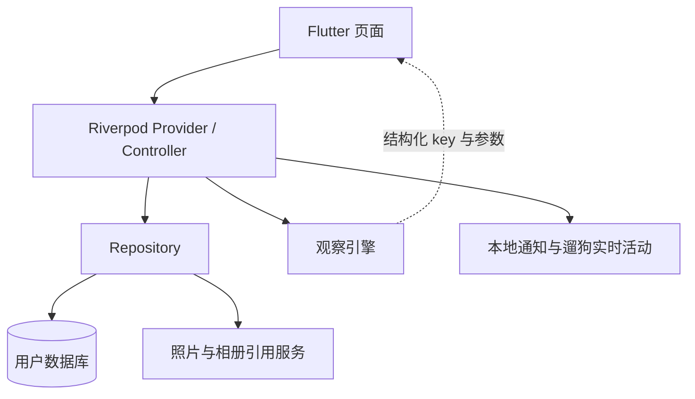

# 架构

更新：2026-10-10。v1 正在按 [v1 开发计划](V1_PLAN.md) 重做。本文只保留 v1 中继续沿用的分层、媒体和平台约定；数据结构与页面结构会在对应阶段完成后补充。旧版的完整架构、数据接口和 UI 说明见 `legacy-v0` 标签。

## 代码分层

- `lib/app`：启动、路由、底栏和主题。
- `lib/core/ui`：颜色与间距 token、页面容器、卡片、选项组、状态视图和动效。
- `lib/core/database`：用户数据库 schema 与迁移。
- `lib/core/knowledge`：独立知识库 schema 与内置条目；v1 中冻结，只作为每日卡片的背景素材。
- `lib/core/files`：照片存储、相册引用和视频播放，通过条件导入隔离平台实现。
- `lib/core/notifications`：通知调度及 iOS Live Activity 桥接。
- `lib/core/l10n`：中英文翻译（ARB）、code 到显示文字的映射、带单位数量与排期的格式化、界面语言的决定。
- `lib/features`：按业务划分 `presentation`、`application`、`data`、`domain`；简单模块不强制包含全部层级。

页面通过 Repository 或 Provider 使用数据，不直接写 Drift 表。引擎和 domain 层不产生面向用户的文案，只输出 code、key 和参数，由页面按当前语言与单位格式化。

## 媒体

- 狗狗照片：原生端保存到应用私有目录，Web 端保存图片字节到浏览器数据库。
- 爱宠时光：iOS 使用 PhotoKit 标识，Android 使用持久 URI，只存引用和元数据，不复制相册原件。
- 时光缩略图：可清理的 100 MB LRU 缓存；清理缓存或删除时光不会删除系统相册原件。
- 相册媒体失效时保留文字与日期，页面展示不可用状态。

## 平台边界

| 平台 | 范围 |
| --- | --- |
| iOS | Flutter 页面、本地数据、相册引用、本地通知和遛狗 Live Activity 原生实现 |
| Android | Flutter 页面、本地数据、相册引用和本地通知；遛狗使用进行中通知 |
| Web | 页面与本地数据库调试；无系统相册引用、通知调度或 Live Activity |
| 桌面 | 部分文件服务有条件实现，不作为完整桌面发行项目维护 |

Web 使用 `web/sqlite3.wasm` 和 `web/drift_worker.js`，浏览器数据与手机数据独立。

Xcode 工程的 Runner 和 WalkActivityExtension 部署目标为 iOS 26.0；Podfile 的插件最低版本配置为 13.0。发行前应核对目标系统、签名、权限和扩展配置。

## 维护约定

- 新增界面文字：在 `lib/core/l10n/arb/` 的 `app_en.arb`（模板，带 `description`）和 `app_zh.arb` 里同时添加，运行 `flutter gen-l10n`；生成的代码提交到仓库。
- 新增存储 code 时，在 `lib/core/l10n/labels.dart` 的对应 switch 里补上翻译；switch 是穷尽的，漏掉会编译失败。
- 显示数量一律经过 `unit_format.dart`，不在页面里自己拼单位。
- 时间写入统一转换为 UTC，页面转换为本地时间；日期筛选采用本地自然日 `[from, to)`。
- 页面按狗狗 ID 订阅数据，切换档案后更新订阅，避免上一只狗狗的数据残留。
- 通知是数据库状态的执行通道，不作为提醒或遛狗的唯一数据源。
- 数据库结构变更须提升 `schemaVersion`，运行 `dart run drift_dev make-migrations` 生成快照与迁移步骤，并补充升级与数据保留测试。
- 仓库只保留当前有效的计划、架构和文案文档；阶段过程记录、本机构建日志和临时配置不提交。
